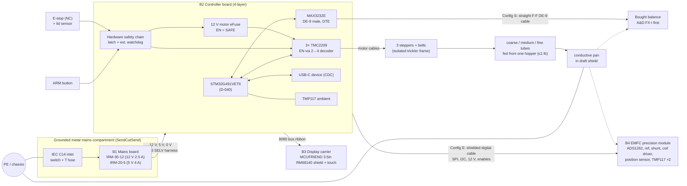
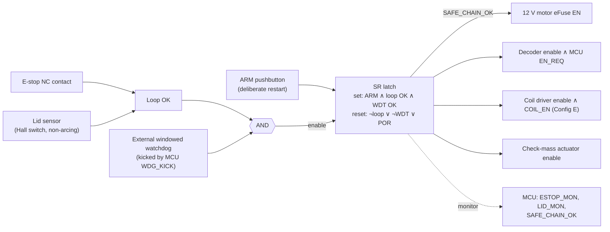

# System architecture (Phase 2): block diagram, board partition, power tree, safety chain

Rev 0 · 2026-11-21 · Status labels per CLAUDE.md. Everything here is **PROPOSED for Gate B** unless it is marked otherwise. Pin-level detail is in `CONTROLLER_IO.md`.

## 1. System block diagram



**Config S vs E.** Config S is B1 + B2 + B3 plus a bought balance on RS-232. Config E adds B4 and the cell, and the RS-232 port stays free. The dispenser mechanics, controller, firmware and enclosure are shared (D-003).

## 2. Board partition (resolves OI-08, PROPOSED)

| Board | Layers | Content | Why it is separate |
|---|---|---|---|
| **B1 Mains** | 2 (mains-rated creepage, slot under the barrier) | IRM-30-12, IRM-20-5, one T fuse per module, PE stud. Inlet fuse and switch sit in the panel-mount C14 | Confines mains to a grounded metal compartment (SAF-05). The IRM modules meet EN55032 Class B **without extra parts** [IRM-20/30 DS], so no on-board EMI filter is planned. The fuses must be **time-lag**: cold-start inrush is 20 A (IRM-20) and 25 A (IRM-30) typical at 115 VAC [DS] |
| **B2 Controller** | 4 | MCU, safety chain, 3× TMC2209, motor eFuse, 3V3 regulator, RS-232, USB-C, TMP117, connectors | One low-noise digital/motor board. Motor-switching return currents stay off the precision module |
| **B3 Display carrier** | 2 | Uno-pattern female headers for the shield, an IDC to B2, and an optional level translator (OI-21) | Lets B2 sit where thermal and EMC want it rather than behind the front panel. 2 layers is enough: no analog content, ground-interleaved ribbon, series-terminated at B2 |
| **B4 EMFC module** (Config E) | 4 | ADS1262, reference, Kelvin shunt, coil driver, position-sensor front end, TMP117 (magnet, coil), local LT3045-class LDOs from 12 V, check-mass actuator driver | Keeps µV-level analog physically and thermally away from motors and switchers (PCB requirements). Config S builds don't pay for it |

Alternative kept open: merge B3 into B2 by mounting B2 directly behind the display. That is one board fewer, but it fixes B2's location at the front panel, near the pan. Decide at Gate B after the enclosure layout sketch.

## 3. Power tree (topology only; numbers come in the OI-09 power budget)

```
IRM-30-12 ── 12 V ──┬─ eFuse (EN = SAFE_CHAIN_OK) ── VM to 3× TMC2209      [motors can't run without SAFE]
                    └─ (Config E) eFuse ── B4: LDOs → precision rails, coil-driver supply
IRM-20-5 ─── 5 V ───┬─ power mux (5 V main ⟷ USB VBUS, TPS2121 class) ── 3V3 regulator ── MCU, logic, TMP117, MAX3232
                    └─ display shield 5 V pin (its own 3.3 V regulator, per OI-21)
USB-C VBUS ─────────┘  (service: logic runs from USB alone; motors and coil stay unpowered)
Battery (Rev B)        connector/footprint only, DNP (D-017)
```

Why USB can power logic alone: firmware service and configuration then work on the bench without mains, and nothing can move. That is a safety property, not only a convenience.

## 4. Grounding and bonding (PROPOSED)

- **PE.** PE bonds to the metal mains compartment, the enclosure base plate, the scale-frame metal and the conductive pan path (DSP-10, SAF-05). It runs from a ring terminal on a dedicated stud, not through a PCB trace.
- **SELV 0 V.** SELV 0 V bonds to PE at **one point**, on B2 at the B1 harness entry, through a 0 Ω link with an RC option. Bring-up decides between hard bond and RC by testing for ground loops. Why: the bought scale's RS-232 SG and a PC's USB ground both tie in, and a single bond point keeps loop currents out of signal grounds.
- **ESD-safe parts.** Static-dissipative printed parts in powder contact (hopper, tubes, funnel) are bonded by a conductive path or contact to the PE-bonded frame. Verification: resistance to PE (DSP-10).

## 5. Safety chain (SAF-01..04; hardware-enforced, firmware only supervises)



- **Cutting is two-layer.** Opening the loop removes motor **power** (the eFuse turns off) and forces every ENN high (the decoder is disabled). There is no MCU path in either (SAF-01).
- **Restart needs the ARM button** with the loop closed. Power-on reset leaves the latch reset, so nothing moves after power-up or a brown-out without a deliberate press.
- **A stalled MCU** stops kicking the watchdog, which resets the latch (SAF-03). The kick is only issued after the health supervisor confirms progress (firmware invariant).
- **One motor at a time** is enforced by the decoder (D-041). The firmware interlock stays as a second layer (SAF-04).
- **The lid sensor** is a Hall switch with a magnet in the lid, so there are no arcing contacts (SAF-06). The E-stop mushroom sits on the front panel, outside the powder zone.
- **Parts.** Windowed watchdog (TPS3431 class) and latch/logic in LVC single gates. These are CANDIDATE parts; datasheets come in Phase 4.

## 6. Physical zoning concept (for the enclosure sketch, ≤ 450 × 350 mm)

```
 rear ┌──────────────────────────────────────────────┐
      │ [B1 mains, metal box]   [B2 controller]       │  heat sources at the rear,
      │                                                │  away from the cell
      │   [trickler frame: hopper + 3 tubes + motors]  │  isolated frame (DSP-07),
      │          ↓ outlets over the pan                │  own feet / decoupled mounts
      │   [draft shield: pan on scale / EMFC cell]     │  cell on its own base plate
 front│ [display + ARM + E-stop]                       │
      └──────────────────────────────────────────────┘
```

Why: the 1 mg cell is sensitive to temperature gradients and vibration, so mains, drivers and motors go to the rear and the trickler frame is not mechanically tied to the cell base. Config S balances sit in the same draft-shield bay, on a per-model adapter (SCS-04).

## 7. What this architecture leaves to the next studies

| Item | Study |
|---|---|
| Analog / digital / hybrid position loop, and the EMFC control line list | Servo study (`/effort max`) |
| Measurand: shunt + ADS1262 vs PWM duty (G474 HRTIM, OI-03) | Servo / measurand study |
| Rail currents and IRM derating; eFuse limits | Power budget (OI-09) |
| Coil driver part (OI-04), reference and shunt (OI-05) | EMFC electronics study |
| Check-mass value and actuator (OI-07) | EMFC mechanics study |
